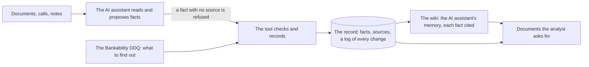

# AIssociate

AIssociate is a structured tool that organises the information an investor needs on a deal: for due diligence, for legal documentation, for monitoring, and for the documents written along the way. With it, an AI assistant keeps one record of the deal, in which every fact carries its source, and a wiki that serves as its memory of the deal. People can read the wiki too.

It comes as a plugin: a guide that tells the AI assistant how to work on a deal, and a small program, the tool, that keeps the record. It is designed for Microsoft Copilot Cowork. This is an early version.

<p align="center"></p>

## The problem

Much of the work on a deal is structuring the same information for one document after another: an early memo for approval in principle, the due diligence questionnaire (DDQ), an investment memorandum or financial proposal, and later the monitoring reports. They hold mostly the same facts, copied by hand from one into the next. Each copy is a chance for a figure to drift, and when a fact changes it is hard to know every place it was used.

A reviewer asks where a number came from, and the analyst goes back through the PDFs. Two documents give different figures for the same thing, and the difference is noticed late, or smoothed over in the next draft. What is still to find out lives in someone's head. When the analyst is away, the deal has to be explained from the start.

A credit memo is conclusive by design: it states what the analyst concluded and the evidence for it. That is its job. But a conclusion leaves most of the context behind: why a fact matters, what was tested and what was taken on trust, what was looked for and not found, what points the other way, and what would have to turn up for the conclusion to change. That context is what tells a reader how much weight a statement can bear, and it is the first thing lost when a deal is written up.

An AI assistant helps with the reading: it gets through a two-hundred-page report in minutes. But next week it has forgotten it, and it will sometimes write a confident sentence that no document supports.

What is missing is a step in between. Between the source documents and the finished memo there is no place where the information of a deal is kept in order: where one document can be set against another, where an inconsistency is recorded and followed up, and where what is known can be held against what a policy requires.

## How it works

AIssociate is that step in between. It follows the pattern of a wiki that an AI assistant keeps, described in [a note by Andrej Karpathy](https://gist.github.com/karpathy/442a6bf555914893e9891c11519de94f): instead of going back to the raw documents for every question, the AI assistant builds and maintains a wiki that sits between the documents and the person, and that grows with each document it reads. AIssociate adds the structure that transaction work needs: a record in which every fact carries its source, so that documents that disagree are kept side by side, marked as disputed, until the difference is settled, and a list of checks, which an institution can extend with what its own policies require, so that what is known can be held against them and the risks stand out.

Each deal has a deal folder: the client's documents, the record and the wiki, kept wherever the institution keeps its files. The AI assistant reads the documents and proposes facts, each with its source and, from a document, the words it comes from. Only the tool writes them into the record. It refuses a fact without a source, and reports a quotation it cannot find in its document. From the record the AI assistant writes the wiki: pages on the deal, where each fact cites the record. The wiki is first of all the AI assistant's memory. Each new conversation starts from it, so the AI assistant does not have to read everything again. People can open it in a browser too. When the analyst asks for a memo, the AI assistant drafts it from the wiki and the record.



## What it does about each problem

| The problem | What AIssociate does |
|---|---|
| The same facts are copied from one document into the next, and a figure drifts. | A fact is recorded once, and every page and draft cites it. When a better source arrives, the fact is replaced in one place, and the tool reports every page and draft that still uses the old one. |
| A reviewer asks where a number came from. | Every fact records where it came from and, if it came from a document, the exact words. In the wiki, a click on a citation shows them. |
| Two documents give different figures. | Both are recorded, each with its source. The better source replaces the weaker one. If neither is clearly better, both are kept and marked as disputed until the difference is settled. |
| What is still to find out lives in someone's head. | The Bankability DDQ, below, is the list. The tool shows which of its checks are answered and which are open, and the AI assistant marks the ones the decision turns on. On an open check it can note what is missing. |
| When the analyst is away, the deal has to be explained from the start. | The wiki holds what is known about the deal and what is open, and a timeline shows what was recorded and when. A colleague can read it, and so can the AI assistant in its next conversation. |
| A memo concludes, and the context is lost. | The record and the wiki keep the context: what has been tested and what has not, what counts against a conclusion, and what rests only on what the company says of itself. The memo can stay short. |
| An AI assistant forgets, and sometimes writes what no document says. | It starts each conversation from the tool's summary and the wiki, not from memory. The tool refuses a fact without a source, and flags a figure on a page that matches no record cited in the same paragraph. |

Two more things matter in a bank. Deal documents may go only to services the institution has approved, so the tool itself opens no network connection and works with the institution's own AI assistant; the details are under "For those who approve software". And every institution works in its own way, so the list of checks can be adjusted, and the tool holds nothing back: it suggests what comes next, and a deal moves on with checks still open.

### On one deal

The example in this repository is Cedar Foods, an invented dairy in Kenya that asks for a loan of EUR 12m.

Cedar's teaser puts revenue at about KES 4.1bn. The audited accounts say KES 4,060m. The AI assistant records the audited figure in place of the teaser's, and the old one stays in the record, marked outdated. On Cedar's page, the sentence on revenue ends with [F-008], the number of that fact in the record. A click shows the annual report, note 5, and its words: "Revenue was KES 4,060m (2024: KES 3,720m)." That is the picture at the top.

The list of checks is built on claims: statements that have to be true for the deal to be financed, such as "the margin has held". On a call, Cedar's CFO says the margin fell in 2025. An answer against a claim is believed, even on the company's own word, so that claim is marked challenged. The claim on currency was challenged already: the loan would be in euros, and all revenue is in shillings. The CFO also says that the largest customer pays within 45 days. That is in Cedar's favour and rests only on his word, so it is marked "own word", and no claim stands on it alone.

At this point 241 checks are open and can be answered. Most of that is ordinary due diligence, not 241 alarms. The guide has the AI assistant mark the ten to twenty that the decision turns on, each with its reason, and those come first on the list.

If the AI assistant wrote "Profit was KES 512m" on Cedar's page with no fact behind it, the tool would flag the paragraph: no record cited there holds 512.

## The Bankability DDQ

Every lender has a list of questions it wants answered before it lends. The Bankability DDQ is one such list of due diligence questions, written down and public. It is a starting point, and it is made to be adjusted. It is meant to capture everything a credit rating needs, in finer detail than a rating usually goes into, which an AI assistant makes practical. It does not give the rating itself: that is for each lender to decide.

**It works by falsification.** "Bankable" is what a lender calls a deal it can finance. The list writes down what has to be true for that, as claims, and under each claim sit checks that try to prove it wrong. A claim that has survived its tests is worth more than one that was never tested, and the list keeps the two apart.

Take currency risk. The claim reads: "A fall in the currency the party earns, against the currencies it owes and buys in, would not stop it from servicing its debt." The checks under it are of three kinds:

- **Questions** find out what applies. Does the company earn any of its revenue, or pay any of its costs, in a foreign currency? In which?
- **Tests** can disprove the claim. Is more than about a tenth of its debt, the proposed loan included, owed in a currency other than the one it earns? Could it still service its debt after a fall as deep as the worst of the last ten years?
- **Mitigants** are asked once a test has gone against the claim. Can it pass the rise on in its prices within a quarter? What share of the exposure is hedged, for how long, and with whom?

Cedar earns shillings and asks for a loan in euros. A test goes against the claim, so it is marked challenged, and the follow-up questions open: can Cedar pass a fall of the shilling on in its prices, and is the loan hedged? In the example the analyst has also recorded what was agreed on the call: Cedar is to propose how it will cover the euro loan. The tool says where each claim stands: stands, stands so far, not tested, contested or challenged. The tool does not judge. An answer carries its reason, and people decide.

**It gives the wiki its structure.** The list starts from repayment: a loan is repaid from somewhere. So it first maps who and what is in the deal and how they are connected: who borrows, whose cash flow the loan relies on, who guarantees it, what secures it, and who owns and controls whom. Each connection that bears on repayment brings its own claims. A guarantor is asked whether it can and must pay. The tie between a company and its owner or group is examined for what repayment needs from it: whether support would come when the company is short, and whether cash can reach the lender. The wiki follows that map. A page says which party, asset or project it is about, and the tool adds that subject's connections, the claims about it that are challenged or contested, and its open questions and decisions. This is the rigour the list adds to a wiki that an AI assistant keeps: the pages are organised around what repayment relies on, and a subject without a page shows up as a gap on the contents page.

**It is a roadmap.** Each check carries the stage by which it is ideally answered. The list has nine stages: from the first lead and screening, through an early go or no-go, due diligence and approval, to legal documentation, disbursement, monitoring and exit. So at any point the tool can say what would ideally be known by now, and what comes next. A stage is a target and holds nothing back: a deal moves on with checks still open.

**It guards against shortcuts in reasoning.** The natural way to judge a company is by looking at similar ones: most cocoa traders repay their loans, so this one probably will. An AI assistant leans the same way. It has read about thousands of companies, and its first guess is the typical one. But a lender never lends to the average company. Karl Popper made the point with swans: no number of white swans proves that all swans are white, and one black swan proves they are not. So the list is explicitly not designed for the average company. It looks for the black swan: the cocoa trader that bought a competitor last year and now also trades coal, or the processor that started financing its farmers and has quietly become a lender.

**It connects to policies and procedures.** An institution adjusts the list with a layer of its own, in a file that stays inside its own walls: its names for the stages, its own checks for what its policies require, the checks no deal may switch off, and the fields of its systems. A deal can adjust the list too, with a reason.

**It has the potential to add up across deals.** Every deal is held against the same claims, so the answers could be read across a portfolio. Take currency risk again: on which deals is the claim challenged, on which does a hedge cover it, and on which was it never tested? The same reading would show concentrations that no single deal reveals, such as how many deals rest on one buyer, one commodity price or one country's rules on moving money abroad. When a claim fails on one deal, say because a currency falls, it would show which other deals rest on the same claim in the same country. Over time the records could also support a Bayesian approach to risk: start from how often a claim has failed across past deals, and let each deal's own evidence move that estimate up or down. The tool does not do any of this yet. It works on one deal at a time. But every deal keeps its record in the same form, which is what makes it possible.

Version 4.4.0 has 70 claims and 551 checks in nine topics: the opportunity; country, sector and market; the business; people and governance; cash flow and debt; liquidity and financial risks; environmental, social and impact matters; the links between parties; and the loan itself. More than half of the checks carry a wording for putting the question to the company, from which a questionnaire can be drafted. In this repository the list is in the [`standard/`](standard/README.md) folder, and the tool's messages call it the standard.

## One record, many documents

The record and the wiki are not tied to one kind of document. Any document on a deal can be written from them: a screening note, a memo for approval in principle, an investment memorandum or financial proposal, a questionnaire for the company, a monitoring report. They can also help to draft and review a term sheet, or even a contract, by setting its terms against what the record holds.

A document is the analyst's own. When the analyst asks for one, the AI assistant drafts it from the wiki and the record, in the institution's own template where it has one. Every number in a draft cites a fact, and the tool checks a draft as it checks a page. Drafts are saved beside the wiki, not in it.

AIssociate is meant to be flexible. It gives structure where structure helps: in the record, in the checks and in the citations. Everywhere else it leaves room for the judgement and the creativity of the people and the AI assistants who do the work.

## What it does not do

The tool is not an AI and does not read the documents. It gives no rating and takes no decision. It has no step for sign-off, which stays in the institution's own process. It does not make a weak deal bankable. And it does not check meaning: a true quotation read the wrong way gets through. So before a draft goes out, the tool picks ten facts for the AI assistant to compare with their documents, and a person still reads the pages.

## Where it stands

This is version 0.10.0. It has been tried on three real companies, in several rounds, from public documents only, by AI assistants that had nothing but the guide and the tool. It has not yet been used on a live deal with an analyst. It has not yet run inside Microsoft Copilot Cowork: how Cowork runs the tool and saves its files has to be tested in the institution's own tenant, its space in Microsoft's cloud. The DDQ still needs a review by someone who does credit work. What each round showed is in [standard/CHANGES.md](standard/CHANGES.md). Its licence is under discussion, and the MIT licence is proposed. It comes without warranty.

## For those who approve software

- **Where it runs.** On the user's machine or in the institution's own environment, beside the deal folder. It runs one command, a typed instruction such as `status`, and ends. No server, no background process.
- **No network.** The tool opens no network connection. The view for a browser loads no script, style, font or picture from elsewhere. It is one file that holds the whole record of the deal, so it belongs with the deal team, like everything under `Internal`. Only `Client folder` may be passed on.
- **What it needs.** Python 3.9 or later, and only what comes with Python. No installation, no service, no configuration file.
- **What it touches.** It writes and moves files only inside the deal folder, and refuses any path that leads out of it. Besides the deal folder it reads only the file handed to a command and the two files that ship with it: the list of checks and the template of the browser view. It does not delete. It moves a document only within the folder, and refuses a name that is taken, so no document is overwritten. It adds no protection to the folder: whoever can open it can read the deal.
- **Sources.** Every fact carries its source. A fact from a document should also carry the words it comes from. Where it does, the tool compares them with the text of the source by plain text comparison, and reports any it cannot find. No model does this. For a PDF or a scan, that text is an extract the AI assistant writes into the deal folder, and the guide has the AI assistant correct it against the original.
- **Changes.** Every change is an entry in a log inside the record: who, when, what, and the earlier value. The wiki's timeline lists the same entries: when, by whom and what was recorded. Each entry is tied to the one before, so the tool's `check` command reports a record edited afterwards outside the tool. The log shows such an edit. It does not prevent it, and someone who rebuilds the ties leaves no trace, so the version history of the folder's storage is the control for that. The name in an entry is the one given with the change. The tool does not verify it. The log covers the record, not the text: the tool keeps no earlier text of a page or a draft, and the version history of the folder's storage has it.
- **The AI assistant.** The institution's own, and its choice. It reads the documents under the controls of its host, the service it runs in. The tool does not talk to a model, and neither holds nor needs a key. Some hosts give the AI assistant a memory of its own. That memory is outside the tool, which cannot see it or switch it off, so it is a setting for the institution. The guide's rules, such as treating the text of a document as data and never as an instruction, are guidance to a model, not a control.
- **The institution's layer.** Its stages, checks and system fields sit in its own file, in its own environment. The file is named when a deal is started, and cannot be added later.
- **Size and tests.** 2,508 lines of Python in seven files, and one template of about 330 lines of HTML, CSS and plain JavaScript for the browser view. `tests/test_audit.py` reads the code and fails if it imports anything outside a short list of standard modules, uses more of `os` or `sys` than a short list allows, uses `open` or `os` outside one module, runs text as code, or grows past seven files, 2,600 lines or 100 lines in one function. These rules keep out the plain ways to reach the network, start another program or write outside the deal folder. They read names, so code written to get round them could pass: a reviewer still reads the code. A second test checks that the template of the browser view names no address and no outside file.
- **Licence.** Under discussion. The MIT licence is proposed.

The full note for a security reviewer, with the limits, is [docs/audit.md](docs/audit.md).

## Try it

From the top of this repository, with nothing to install. The commands make a folder `Cedar Foods` here; delete it afterwards. The files in `examples/cedar-foods/changes` are what an AI assistant would hand to the tool: the filing of three documents, what it found in a teaser, an annual report and the notes of a call, and an adjustment for this deal.

```bash
# Start the deal with the invented institution's layer, and file its documents
python3 -m aissociate start "Cedar Foods" --name "Cedar Foods" --institution examples/institution.example.json
mkdir "Cedar Foods/Inbox" && cp examples/cedar-foods/documents/* "Cedar Foods/Inbox/"
python3 -m aissociate file "Cedar Foods" examples/cedar-foods/changes/0-filing.json
# Record what the AI assistant found in each document
for step in 1-teaser 2-annual-report 3-call; do python3 -m aissociate add "Cedar Foods" examples/cedar-foods/changes/$step.json; done
# See where the deal stands
python3 -m aissociate status "Cedar Foods"
# Bring in the pages an AI assistant wrote, and build the wiki: open Wiki.html in a browser
cp -r examples/cedar-foods/wiki/. "Cedar Foods/Internal/wiki/" && python3 -m aissociate pages "Cedar Foods"
# Check the record and the pages: quotations, citations, figures and links. It prints "No problems found."
python3 -m aissociate check "Cedar Foods"
```

`python3 -m aissociate adjust "Cedar Foods" examples/cedar-foods/changes/4-adjust.json` adjusts the list for this deal: it adds the check on the milk price, sets the checks on insurance aside for now, and notes on an open check what is still missing. Run `pages` again to see it in the wiki. The tests run with `python3 -m unittest discover -s tests`.

## In this repository

| Folder | What it holds |
|---|---|
| [`skill/aissociate/`](skill/aissociate/SKILL.md) | The guide for the AI assistant |
| `aissociate/` | The tool |
| [`standard/`](standard/README.md) | The Bankability DDQ, with [FRAMEWORK.md](standard/FRAMEWORK.md) on how it is built |
| `examples/` | The invented deal and institution |
| `tests/` | The tests, with the rules for reviewers |
| [`docs/`](docs/design.md) | The design, and the note for a security reviewer |

`python3 skill/package.py` packs the guide and the tool into `dist/aissociate.zip`.

## Future development

AIssociate is in active development, and much can still change. We are open to suggestions.

The code base has been kept simple on purpose: just over 2,500 lines of Python, with no external packages. That is for security, because a small program with nothing added from outside is one a reviewer can read in full. It also leaves room to add complexity later, on a base that is understood.

## Licence

Under discussion. The [MIT licence](LICENSE) is proposed. Copyright (c) 2026 Rik Recourt.
