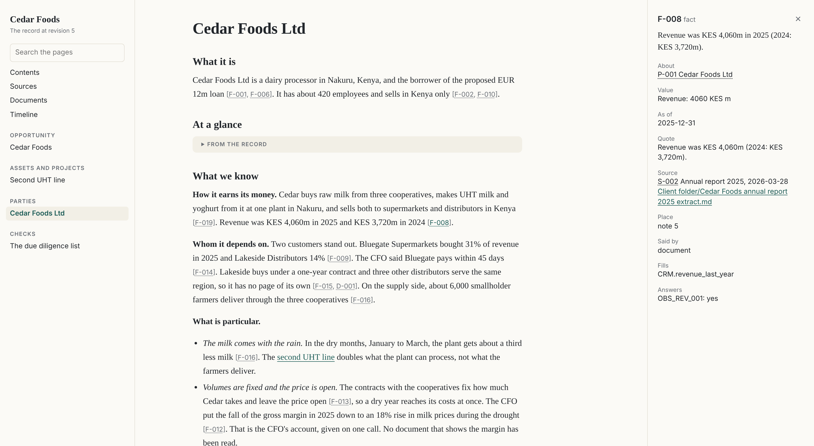
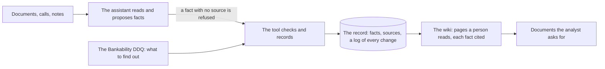

# AIssociate

The AIssociate plugin keeps one record of an investment deal, in which every fact carries its source. Everything written about the deal comes from that record: the wiki that colleagues read, and the documents the analyst asks for.

A plugin is a folder for an AI assistant. This one holds a guide that tells the assistant how to work on a deal, and a small program, the tool, that keeps the record. It is meant first for Microsoft Copilot Cowork, Microsoft's assistant for office work. It has been tried on three real companies, from public documents only, and not yet on a live deal.

<p align="center"></p>

## The problem

Much of the work on a deal is structuring the same information for one document after another: an early memo for approval in principle, the due diligence questionnaire (DDQ), an investment memorandum or financial proposal, and later the monitoring reports. They hold mostly the same facts, copied by hand from one into the next. Each copy is a chance for a figure to drift, and when a fact changes it is hard to know every place it was used.

A reviewer asks where a number came from, and the analyst goes back through the PDFs. What is still to find out lives in someone's head. When the analyst is away, the deal has to be explained from the start. And a memo written to get a deal approved tends to lose what speaks against it.

An AI assistant helps with the reading: it gets through a two-hundred-page report in minutes. But next week it has forgotten it, and it will sometimes write a confident sentence that no document supports.

These look like separate problems. Most of them come down to one: the facts of a deal have no home of their own. They live in whichever document was written last.

## How it works

AIssociate gives the facts a home. Each deal has a deal folder: the client's documents, the record and the wiki, kept wherever the institution keeps its files. The assistant reads the documents and proposes facts, each with its source and, from a document, the words it comes from. Only the tool writes them into the record. It refuses a fact without a source, and reports a quotation it cannot find in its document. From the record the assistant writes the wiki: pages on the deal that a person reads in a browser, where each fact cites the record. When the analyst asks for a memo, the assistant drafts it from the wiki and the record.



The idea of a wiki that an assistant keeps comes from [a note by Andrej Karpathy](https://gist.github.com/karpathy/442a6bf555914893e9891c11519de94f).

## What it does about each problem

The example is Cedar Foods, an invented dairy in Kenya that asks for a loan of EUR 12m.

### Figures drift from one document to the next

Cedar's teaser puts revenue at about KES 4.1bn, the audited accounts at KES 4,060m. The guide says the better source wins, so the assistant records the audited figure as replacing the teaser's. The old fact stays, marked outdated, and the log shows who replaced it. The tool's check reports every page and draft that still cites it. Two equal sources that disagree are both marked disputed.

### It is hard to say where a number came from

On Cedar's page, a sentence on revenue ends with [F-008]. A click shows the fact: the annual report, note 5, and its words, "Revenue was KES 4,060m (2024: KES 3,720m)." The tool compares each quotation with the text of its document, by plain comparison, and reports any it cannot find. No AI does this.

### What is still missing lives in someone's head

The list is the Bankability DDQ, below. For each of its checks, the questions it asks, the tool knows whether it is answered, open, waiting for something else first, set aside, or not relevant, and by which stage it is ideally answered. For Cedar, 241 checks can be answered now. That is ordinary due diligence, not 241 alarms. The assistant marks the few that would change the decision, each with its reason, and those come first on the list. On an open check it can also note what is missing, and who could give it.

### The assistant forgets, and sometimes writes what no document says

Each new conversation starts from the tool's summary and the pages, so what is known about the deal does not rest on what the assistant remembers. The tool refuses a fact without a source. Had the assistant written "Profit was KES 512m" on Cedar's page, the tool would report that the paragraph "has 512, which no record cited in that paragraph holds."

The tool does not check meaning, so a true quotation read the wrong way gets through. Before a draft goes out, the tool picks ten facts and the assistant compares each with its document. A person still reads the pages.

### A memo tends to argue for the deal

The DDQ is built on claims that could turn out false, such as "the margin has held". Cedar's CFO said on a call that the margin fell in 2025. A company's word against its own interest is believed, so that claim is marked challenged. So is the claim on currency: the loan would be in euros, and every sale is in shillings. Both are listed on Cedar's page, in the part the tool keeps. The CFO's word that the largest customer pays within 45 days is in Cedar's favour, so it is marked "own word", and no claim stands on it alone.

### A deal is hard to hand over

The assistant writes the wiki for someone who has never seen the deal, and the tool keeps part of each page. Cedar's page lists, in the part the tool keeps, the two challenged claims, the open request for the milk contracts and the agreed action on covering the euro loan. A colleague who takes over starts there. A timeline in the wiki shows what was recorded, when and by whom.

### A bank cannot send its deals to a new service

The tool is about 2,500 lines of Python, a common programming language. It runs where the deal folder is, opens no network connection, and uses the institution's own assistant. A test in this repository, the public home of the code, fails if the code brings in anything that could reach the network or start another program, or grows too large.

### Every institution works in its own way

A check has a stage by which it is ideally answered, but a deal moves on with checks still open. An institution keeps its own ways in a file of its own. The invented one in the example renames two of the stages, makes sanctions screening a check no deal may switch off, and lists the fields of its client system. For Cedar the analyst adds a check, with its reason: do the milk contracts cap the price?

## The Bankability DDQ

Every lender has a list of questions it wants answered before it lends. The Bankability DDQ is one such list of due diligence questions, written down and public. It is a starting point, and it is made to be adjusted.

"Bankable" is what a lender calls a deal it can finance. The list writes down what has to be true for that, as claims, such as "No single customer's loss would stop the company from servicing its debt." Under each claim sit checks that try to disprove it. A check says what evidence would answer it, and by which stage of the deal it is ideally answered.

Version 4.4.0 has 70 claims and 551 checks in nine topics: the opportunity; country, sector and market; the business; people and governance; cash flow and debt; liquidity and financial risks; environmental, social and impact matters; the links between parties; and the loan itself. Nothing is scored. An answer carries its reason. The tool says where each claim stands: stands, stands so far, not tested, contested or challenged. People decide.

An institution adjusts the list with a layer of its own, in a file that stays inside its own walls: its stages, its own checks, the checks no deal may switch off, and the fields of its systems. A deal can adjust it too, with a reason. The questions meant for the company make up the questionnaire that goes to it. In this repository the list is in the [`standard/`](standard/README.md) folder, and the tool's messages call it the standard.

## One record, many documents

A memo is the analyst's document. When the analyst asks for one, the assistant drafts it from the wiki and the record, in the institution's own template where it has one. The guide covers three:

- **The screening note**: whether the opportunity fits, its fatal flaws, what to do next.
- **The memo for approval in principle**: the opportunity in short, and the claims still to test.
- **The investment memorandum or financial proposal**: for each claim that matters, what tested it and how strong the evidence is.

Every number in a draft cites a fact, and the tool checks a draft as it checks a page. Drafts are saved beside the wiki, not in it. The tool also fills the entry sheets for the institution's systems: each field with its value and its fact, or "missing".

The questionnaire for the company has no set form yet. The tool lists the open checks, and more than half of the DDQ's checks carry a question worded for the company. Monitoring reports are not covered.

## What it does not do

The tool is not an AI and does not read the documents. It gives no rating and takes no decision. It has no step for sign-off, which stays in the institution's own process. It does not make a weak deal bankable.

## Where it stands

This is version 0.9.0. It has been tried on three real companies, in several rounds, from public documents only, by assistants that had nothing but the guide and the tool. It has not yet been used on a live deal with an analyst. It has not yet run inside Microsoft Copilot Cowork: how Cowork runs the tool and saves its files has to be tested in the institution's own tenant, its space in Microsoft's cloud. The DDQ still needs a review by someone who does credit work. What each round showed is in [standard/CHANGES.md](standard/CHANGES.md). It is free under the MIT licence, and comes without warranty.

## For those who approve software

- **Where it runs.** On the user's machine or in the institution's own environment, beside the deal folder. It runs one command, a typed instruction such as `status`, and ends. No server, no background process.
- **No network.** The tool opens no network connection. The view for a browser loads no script, style, font or picture from elsewhere. It is one file that holds the whole record of the deal, so it belongs with the deal team, like everything under `Internal`. Only `Client folder` may be passed on.
- **What it needs.** Python 3.9 or later, and only what comes with Python. No installation, no service, no configuration file.
- **What it touches.** It writes and moves files only inside the deal folder, and refuses any path that leads out of it. Besides the deal folder it reads only the file handed to a command and the two files that ship with it: the list of checks and the template of the browser view. It does not delete. It moves a document only within the folder, and refuses a name that is taken, so no document is overwritten. It adds no protection to the folder: whoever can open it can read the deal.
- **Sources.** Every fact carries its source. A fact from a document should also carry the words it comes from. Where it does, the tool compares them with the text of the source by plain text comparison, and reports any it cannot find. No model does this. For a PDF or a scan, that text is an extract the assistant writes into the deal folder, and the guide has the assistant correct it against the original.
- **Changes.** Every change is an entry in a log inside the record: who, when, what, and the earlier value. The wiki's timeline lists the same entries: when, by whom and what was recorded. Each entry is tied to the one before, so the tool's `check` command reports a record edited afterwards outside the tool. The log shows such an edit. It does not prevent it, and someone who rebuilds the ties leaves no trace, so the version history of the folder's storage is the control for that. The name in an entry is the one given with the change. The tool does not verify it. The log covers the record, not the text: the tool keeps no earlier text of a page or a draft, and the version history of the folder's storage has it.
- **The assistant.** The institution's own, and its choice. It reads the documents under the controls of its host, the service it runs in. The tool does not talk to a model, and neither holds nor needs a key. Some hosts give the assistant a memory of its own. That memory is outside the tool, which cannot see it or switch it off, so it is a setting for the institution. The guide's rules, such as treating the text of a document as data and never as an instruction, are guidance to a model, not a control.
- **The institution's layer.** Its stages, checks and system fields sit in its own file, in its own environment. The file is named when a deal is started, and cannot be added later.
- **Size and tests.** About 2,500 lines of Python in seven files. `tests/test_audit.py` reads the code and fails if it imports anything outside a short list of standard modules, none of which can reach the network or start another program. It also fails if the code reads an environment variable, runs text as code, touches the disk outside one module, or grows past the size the test allows. The test reads the Python only. For the script of the browser view it checks that the template names no address and no outside file.
- **Licence.** MIT.

The full note for a security reviewer, with the limits, is [docs/audit.md](docs/audit.md).

## Try it

From the top of this repository, with nothing to install. The commands make a folder `Cedar Foods` here; delete it afterwards. The files in `examples/cedar-foods/changes` are what an assistant would hand to the tool after reading a teaser, an annual report and the notes of a call.

```bash
# Start the deal with the invented institution's layer, and file its documents
python3 -m bankability2 start "Cedar Foods" --name "Cedar Foods" --institution examples/institution.example.json
mkdir "Cedar Foods/Inbox" && cp examples/cedar-foods/documents/* "Cedar Foods/Inbox/"
python3 -m bankability2 file "Cedar Foods" examples/cedar-foods/changes/0-filing.json
# Record what the assistant found in each document
for step in 1-teaser 2-annual-report 3-call; do python3 -m bankability2 add "Cedar Foods" examples/cedar-foods/changes/$step.json; done
# See where the deal stands
python3 -m bankability2 status "Cedar Foods"
# Bring in the pages an assistant wrote, and build the wiki: open Wiki.html in a browser
cp -r examples/cedar-foods/wiki/. "Cedar Foods/Internal/wiki/" && python3 -m bankability2 pages "Cedar Foods"
# Check the record and the pages: quotations, citations, figures and links. It prints "No problems found."
python3 -m bankability2 check "Cedar Foods"
```

`python3 -m bankability2 adjust "Cedar Foods" examples/cedar-foods/changes/4-adjust.json` adjusts the list for this deal: it adds the check on the milk price, sets the checks on insurance aside until the term sheet is agreed, and notes on an open check what is still missing. Run `pages` again to see it in the wiki. The tests run with `python3 -m unittest discover -s tests`.

## In this repository

| Folder | What it holds |
|---|---|
| [`skill/aissociate/`](skill/aissociate/SKILL.md) | The guide for the assistant |
| `bankability2/` | The tool |
| [`standard/`](standard/README.md) | The Bankability DDQ, with [FRAMEWORK.md](standard/FRAMEWORK.md) on how it is built |
| `examples/` | The invented deal and institution |
| `tests/` | The tests, with the rules for reviewers |
| [`docs/`](docs/design.md) | The design, and the note for a security reviewer |

`python3 skill/package.py` packs the guide and the tool into `dist/aissociate.zip`.

## Licence

[MIT](LICENSE). Copyright (c) 2026 Rik Recourt.
